<div align="center">


# Pocket Monster · Tu primera aventura

**¡Bienvenido al mundo de los Pokémon, entrenador!**

*Guía web para entrenadores Pokémon novatos, organizada por generaciones.*

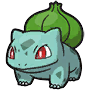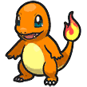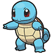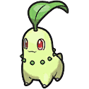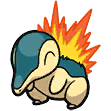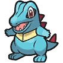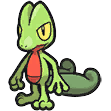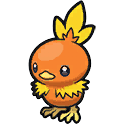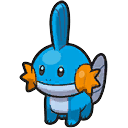

### 🗺️ [¡Empieza tu aventura en Kanto!](https://marcotecdev.github.io/guia-entrenador-novato/)


</div>

---

> 🧑‍🔬 **Profesor:** ¡Hola! ¡Bienvenido al mundo de los POKéMON!
> Este es un proyecto de clase de **1º de DAW**, entrenado solo con **HTML y CSS**.
> Tu aventura está a punto de comenzar... ▼

---

## 🎒 Mochila · Contenido de la web

| Objeto | Descripción |
| :---: | --- |
| 🏠 **Página de inicio** | Una tarjeta por cada generación: número, región, juegos, año y la consola en la que salió. |
| 🗺️ **10 páginas de generación** | De Kanto a la generación 10, cada una con su color y con estas secciones: historia de la región, mapa, juegos (originales, remakes, secuelas y DLC), tráileres de YouTube (con `<iframe>`) y Pokémon iniciales. |
| ✉️ **Página de contacto** | 🚧 En construcción. |
| 🔀 **Rutas** | Enlaces para ir a la generación anterior y a la siguiente. |
| 📱 **Diseño adaptable** | Funciona en ordenador, tablet y móvil. |
| 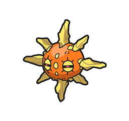 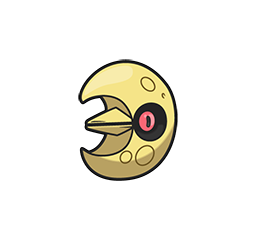 **Modo día / noche** | Modo día (icono de Solrock, fondo de Reshiram) y modo noche (icono de Lunatone, fondo de Zekrom), hecho solo con CSS. |

---

## 🧭 Mapa de la región · Estructura del proyecto

```
🗺️ guia-entrenador-novato/
├── 🏠 index.html               Pueblo de origen: página de inicio (se queda fuera para que GitHub Pages la encuentre)
├── 🛤️ paginas/
│   ├── ✉️ contacto.html        Página de contacto
│   └── 📍 generaciones/
│       ├── generacion-1.html    Páginas de cada generación
│       ├── ...
│       └── generacion-10.html
├── 🎨 css/
│   ├── estilos.css          Hoja de estilos de toda la web
│   └── fuentes/             Fuente pixel Press Start 2P
├── 🖼️ img/
│   ├── caratulas/           Carátulas de los juegos, una carpeta por generación (gen1... gen10)
│   ├── wallpaper/           Fondos de pantalla del modo día (Reshiram) y noche (Zekrom)
│   ├── modoNocheDia/        Iconos del botón de modo: Solrock (día) y Lunatone (noche)
│   ├── consolas/            Imágenes de las consolas de cada generación
│   ├── pokemon/
│   │   ├── ilustraciones/   Ilustraciones oficiales de los iniciales
│   │   └── iconos/          Iconos de menú de los iniciales (Escarlata y Púrpura)
│   ├── regiones/            Una carpeta por región (1-kanto, 2-johto... 10-por-descubrir)
│   │   ├── 1-kanto/mapa.png      Mapa de la región (aquí van también sus carátulas e iniciales)
│   │   ├── ...
│   │   └── 9-paldea/             Mapa e imágenes de los DLC (dlc1-..., dlc2-...)
│   └── en-construccion.jpg  Imagen de las páginas en construcción
└── 📼 media/                Audio y vídeo (vacía de momento)
```

---

## ⚔️ Movimientos aprendidos · Tecnologías

<div align="center">

| Movimiento | Tipo | Efecto |
| --- | :---: | --- |
| **HTML5** | 🟠 Estructura | Esqueleto de todas las páginas. |
| **CSS3** | 🔵 Estilo | Flexbox, grid, `@font-face`, `@media` para móvil y transiciones con `:hover`. |
| **`:has()`** | 🌗 Especial | El botón de modo día / noche funciona con un checkbox escondido y este selector. |

</div>

> ⚠️ **¡JavaScript no está en el equipo!** La web no usa JavaScript ni librerías externas.
> Todo funciona en local salvo los tráileres, que se cargan desde YouTube y necesitan internet.

---

## 🎮 ¡Pulsa START! · Cómo verla en local


1. **Captura** el repositorio (descárgalo o clónalo):
   ```bash
   git clone https://github.com/MarcoTecDev/guia-entrenador-novato.git
   ```
2. **Abre** `index.html` en el navegador.
3. ¡Elige a tu inicial y empieza a explorar! 🔴⚪

---

## 📜 Pokédex de créditos

- **Fuente:** [Press Start 2P](https://fonts.google.com/specimen/Press+Start+2P), de CodeMan38, licencia SIL Open Font License.
- **Imágenes de los Pokémon:** [PokeAPI/sprites](https://github.com/PokeAPI/sprites): ilustraciones oficiales e iconos de menú de Escarlata y Púrpura, recortados y redimensionados.
- **Iniciales de la generación 10** (Browt, Pombon y Gecqua): ilustraciones oficiales tomadas de [WikiDex](https://www.wikidex.net/wiki/Pok%C3%A9mon_Viento_y_Pok%C3%A9mon_Oleaje).
- **Sprites de la generación 10:** hechos por [CarnekVT](https://www.deviantart.com/carnekvt/art/Pokemon-Winds-and-Waves-Starters-in-Sprite-version-1303886486) en DeviantArt (aún no hay sprites oficiales).
- **Carátulas de los juegos:** [WikiDex](https://www.wikidex.net), ajustadas a un mismo tamaño cuadrado (440 × 440).
- **Fondos de Reshiram y Zekrom:** wallpapers de MapleRose.
- **Imágenes de consolas:** tema «Systematic» de [RetroArch Assets](https://github.com/libretro/retroarch-assets) (libretro), licencia [CC BY 4.0](https://creativecommons.org/licenses/by/4.0/deed.es). Recortadas y redimensionadas.
- **Pokémon** y sus personajes son © Nintendo, Game Freak y The Pokémon Company. Este es un proyecto educativo sin ánimo de lucro y no tiene relación oficial con ellos.

---

<div align="center">

## 🏆 Entrenador

**MarcoTecDev** · [GitHub](https://github.com/MarcoTecDev)


*¡Hazte con todos!* ✨

</div>
